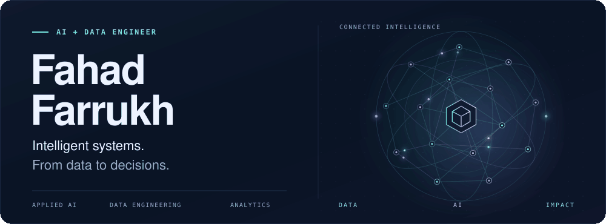
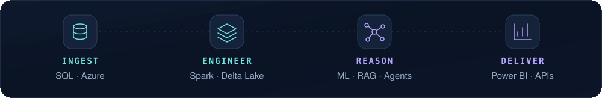
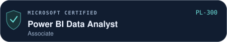
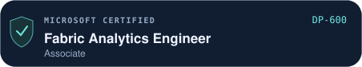
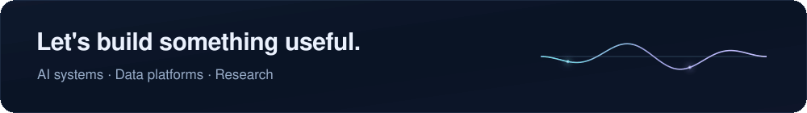

<!-- Upload README.md and the entire assets folder to FahadFarrukh/FahadFarrukh. -->

<picture>
  <source media="(prefers-reduced-motion: reduce) and (max-width: 600px)" srcset="./assets/hero-mobile.png">
  <source media="(prefers-reduced-motion: reduce)" srcset="./assets/hero.png">
  <source media="(max-width: 600px)" srcset="./assets/hero-mobile.gif">
  
</picture>

  
  &nbsp;
  
  &nbsp;
  

I build **AI applications, cloud data pipelines and analytics systems**. Based in Lille, France, I’m pursuing a **Master of Science and Engineering in Big Data at Junia ISEN (2025–2027)**. Previously, I worked as an **AI Research Intern at UMONS** and an **AI Engineer & Microsoft BI Consultant at Jaffer Business Systems**.

<picture>
  <source media="(prefers-reduced-motion: reduce) and (max-width: 600px)" srcset="./assets/workflow-mobile.png">
  <source media="(prefers-reduced-motion: reduce)" srcset="./assets/workflow.png">
  <source media="(max-width: 600px)" srcset="./assets/workflow-mobile.gif">
  
</picture>

## Selected work

<table>
  <tr>
    <td width="50%" valign="top">
      01 / APPLIED AI RESEARCH · UMONS
      <h3>VisIA · Language understanding</h3>
      
AI for blind and visually impaired users. CRF achieved <b>97.3% exact-span F1</b>; neuro-symbolic learning improved test macro-F1 from <b>93.5% to 94.9%</b>.

      Python · PyTorch · NLP · Neuro-symbolic AI
    </td>
    <td width="50%" valign="top">
      02 / DATA ENGINEERING · PERSONAL PROJECT
      <h3>Databricks lakehouse & BI</h3>
      
Built a <b>Bronze–Silver–Gold lakehouse</b> with PySpark transformations, incremental data updates, dimensional modeling and Power BI analytics.

      Databricks · Delta Lake · ADLS Gen2 · Power BI
    </td>
  </tr>
  <tr>
    <td width="50%" valign="top">
      03 / AGENTIC AI · JBS TECHNICAL LEAD
      <h3>Multi-agent SQL RAG finance</h3>
      
Translated natural-language questions into <b>validated SQL</b> over warehouse views, with KPI analysis and visualizations. Reduced manual reporting effort by <b>nearly 60%</b>.

      CrewAI · LangChain · OpenAI · SQL · Flask
    </td>
    <td width="50%" valign="top">
      04 / ACCESSIBLE AI · JUNIA CAPSTONE
      <h3>OFA · Multi-agent assistant</h3>
      
Built a disability-support assistant with <b>LangGraph agents, RAG and MCP tools</b>, French-source retrieval, voice interaction, OCR and accessible display modes.

      LangGraph · MCP · ChromaDB · Flask
    </td>
  </tr>
</table>

<b>Explore the architectures & research</b>

### VisIA · University of Mons · Jun–Sep 2026

- Benchmarked **CRF, CamemBERT and mT5** for information extraction from noisy French transcripts. Audited data leakage using **LaBSE/E5 embeddings and template checks**.
- Built a **LaBSE + MLP** classifier for seven user intents and compared six neuro-symbolic approaches: **LTN, Semantic Loss, DeepProbLog, LNN-style, NeurASP-style and DeepStochLog-style**.
- LTN improved test macro-F1 from **93.5% to 94.9%** and **halved rule violations** on the project's evaluation data.

### Databricks lakehouse · Personal project

**SQL Server → ADLS Gen2 → Bronze Delta tables → Silver PySpark transformations → Gold dimensional warehouse → Power BI.**

Used AdventureWorks data, schema enforcement, cleansing, incremental updates with CDC and **Delta MERGE**, sales and inventory fact tables, and conformed dimensions.

### SQL RAG finance assistant · JBS

**Natural-language question → finance agents → validated SQL → warehouse views via ODBC → KPI analysis and visualizations.**

Led the implementation using **CrewAI, LangChain, OpenAI and Flask**. My wider JBS work included an **Azure OpenAI + ChromaDB HR policy assistant**, conversational voice AI, and **Azure Data Factory / Synapse pipelines with Power BI semantic models**.

### OFA · Junia ISEN M1 capstone

Built a hierarchical **LangGraph** workflow connecting specialist agents, French-source RAG, **MCP tools** and **Tavily search**. Integrated **Flask, SQL Server, ChromaDB, OpenAI and NVIDIA-hosted models**, with voice input/output, OCR, dyslexia-friendly typography and color-blind display modes.

[View my portfolio →](https://fahadfarrukh.netlify.app/#projects)

## Core stack

| Area | Technologies & methods |
| :--- | :--- |
| **AI & agents** | Python · LangChain · LangGraph · CrewAI · MCP · Azure OpenAI · RAG |
| **ML & research** | PyTorch · Hugging Face · scikit-learn · XGBoost · NLP · Neuro-symbolic AI |
| **Data & cloud** | SQL · Databricks · PySpark · Delta Lake · Azure · Snowflake · GCP |
| **Analytics & BI** | Power BI · Microsoft Fabric · DAX · Semantic modeling · ETL/ELT |

## Microsoft certifications

  
  

<b>Additional learning</b>

- **Enterprise AI and Data Engineering with Databricks Specialization** — Pragmatic AI Labs
- **Build Data Lakes and Data Warehouses on Google Cloud** — Google Cloud
- **Spark, Hadoop, and Snowflake for Data Engineering** — Duke University
- **SQL for Data Science** — University of California, Davis

 

<a href="mailto:fahadfarrukh26@gmail.com">
  <picture>
    <source media="(prefers-reduced-motion: reduce) and (max-width: 600px)" srcset="./assets/footer-mobile.png">
    <source media="(prefers-reduced-motion: reduce)" srcset="./assets/footer.png">
    <source media="(max-width: 600px)" srcset="./assets/footer-mobile.gif">
    
  </picture>
</a>
