<picture>
  <source media="(max-width: 600px) and (prefers-color-scheme: dark)" srcset="./assets/hero-mobile-dark.svg">
  <source media="(max-width: 600px) and (prefers-color-scheme: light)" srcset="./assets/hero-mobile-light.svg">
  <source media="(prefers-color-scheme: dark)" srcset="./assets/hero-dark.svg">
  <source media="(prefers-color-scheme: light)" srcset="./assets/hero-light.svg">
  
</picture>

  <a href="https://fahadfarrukh.netlify.app/"><strong>Explore my portfolio ↗</strong></a>
  &nbsp;&nbsp; · &nbsp;&nbsp;
  <a href="https://www.linkedin.com/in/fahad-farrukh-ff26/">LinkedIn</a>
  &nbsp;&nbsp; · &nbsp;&nbsp;
  <a href="mailto:fahadfarrukh26@gmail.com">Get in touch</a>

I build **AI applications and the data systems behind them** — from multi-agent RAG and language understanding to lakehouse pipelines and business intelligence.

Based in **Lille, France**, pursuing a **Master of Science and Engineering in Big Data at Junia ISEN (2025–2027)**. My work combines applied AI research at **UMONS** with enterprise AI and Microsoft BI delivery at **Jaffer Business Systems**.

### Research meets delivery

| **97.3%** | **93.5% → 94.9%** | **Nearly 60%** |
| :--- | :--- | :--- |
| CRF exact-span F1 Information extraction · UMONS | Test macro-F1 with LTN Intent classification · UMONS | Less manual reporting effort Multi-agent SQL RAG · JBS |

**AI Research Intern · University of Mons** &nbsp; / &nbsp; Jun–Sep 2026  
Language understanding for **VisIA**, an assistant for blind and visually impaired users. Information extraction, data-leakage audits, intent classification, and neuro-symbolic AI.

**AI Engineer & Microsoft BI Consultant · Jaffer Business Systems** &nbsp; / &nbsp; Jun 2024–Jul 2025  
Enterprise RAG and multi-agent systems, conversational AI, Azure data pipelines, data warehouses, and Power BI semantic models.

### Selected work

<strong>01 &nbsp; VisIA · Language understanding & neuro-symbolic AI</strong>

Built and benchmarked **CRF, CamemBERT, and mT5** pipelines for extracting information from noisy French transcripts. Audited data leakage using **LaBSE/E5 embeddings and template checks** to improve evaluation reliability.

Developed a **LaBSE + MLP** classifier for seven intents and benchmarked six neuro-symbolic approaches. **LTN** improved test macro-F1 from **93.5% to 94.9%** and reduced rule violations by **50%**.

`Python` `PyTorch` `NLP` `LaBSE` `Logic Tensor Networks`

<strong>02 &nbsp; Multi-agent SQL RAG · Financial intelligence</strong>

Led development of a financial assistant using **CrewAI, LangChain, and OpenAI**. Finance-specific agents translated natural-language questions into validated SQL over **data warehouse views via ODBC**, with KPI analysis and dynamic visualizations in a **Flask** portal.

Reduced manual financial reporting effort by **nearly 60%**.

`Multi-agent systems` `SQL RAG` `CrewAI` `LangChain` `Flask`

<strong>03 &nbsp; Databricks lakehouse · Data engineering & BI</strong>

Built an **AdventureWorks lakehouse** using **Databricks, Delta Lake, and a Bronze–Silver–Gold architecture**. Ingested SQL Server data through **ADLS Gen2**, then used **PySpark** for schema enforcement, cleansing, and incremental updates with CDC and **Delta MERGE**.

Modeled sales and inventory fact tables with conformed dimensions, connecting the Gold warehouse to **Power BI** for business analytics.

`Databricks` `PySpark` `Delta Lake` `ADLS Gen2` `Power BI`

<strong>04 &nbsp; OFA · Accessible multi-agent AI assistant</strong>

Built a disability-support assistant with a **hierarchical LangGraph workflow**, specialized agents, RAG over French sources, **MCP tools**, and **Tavily web search**.

Integrated **OpenAI and NVIDIA-hosted models**, document OCR, voice input/output, dyslexia-friendly typography, and color-blind display modes with **Flask, SQL Server, and ChromaDB**.

`LangGraph` `RAG` `MCP` `ChromaDB` `Accessible AI`

<a href="https://fahadfarrukh.netlify.app/#projects">Explore more projects in my portfolio →</a>

### Tools I work with

| Area | Core stack |
| :--- | :--- |
| **Foundations** | Python · SQL · Git · Docker |
| **AI & agents** | LangChain · LangGraph · CrewAI · MCP · Azure OpenAI · ChromaDB |
| **Machine learning** | PyTorch · scikit-learn · Hugging Face · XGBoost |
| **Data engineering** | Databricks · PySpark · Delta Lake · Azure Data Factory · Snowflake · GCP |
| **Analytics & BI** | Power BI · Microsoft Fabric · SQL Server · DAX · Dimensional modeling |

### Credentials

**Microsoft Certified: Fabric Analytics Engineer Associate · DP-600**  
**Microsoft Certified: Power BI Data Analyst Associate · PL-300**

Additional learning in Databricks, Google Cloud, and data engineering

- **Enterprise AI and Data Engineering with Databricks Specialization** — Pragmatic AI Labs
- **Build Data Lakes and Data Warehouses on Google Cloud** — Google Cloud
- **Spark, Hadoop, and Snowflake for Data Engineering** — Duke University

---

  Interested in building something at the intersection of <strong>AI, data, and real-world impact</strong>? 
  <a href="mailto:fahadfarrukh26@gmail.com"><strong>Let's connect →</strong></a>

