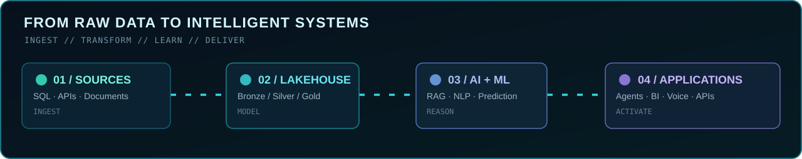

<!--
  GITHUB PROFILE // FAHAD FARRUKH
  Futuristic AI & Data Engineering GitHub Profile
  Animated SVG files are stored in the repository root.
  No JavaScript or embedded iframes required.
-->

  

  

  
  
  

  <a href="#about">About</a> &nbsp;·&nbsp;
  <a href="#experience">Experience</a> &nbsp;·&nbsp;
  <a href="#projects">Projects</a> &nbsp;·&nbsp;
  <a href="#stack">Tech stack</a> &nbsp;·&nbsp;
  <a href="#credentials">Credentials</a> &nbsp;·&nbsp;
  <a href="#analytics">Analytics</a> &nbsp;·&nbsp;
  <a href="#connect">Connect</a>

---

## `01 // ABOUT` 🧬

**I build intelligent systems where AI, data engineering, and software meet.**

I'm **Fahad Farrukh**, an **AI & Data Engineer** based in **Lille, France**, pursuing a **Master of Science and Engineering in Big Data at Junia ISEN Lille (2025–2027)**. I previously worked as an **AI Research Intern at the University of Mons (UMONS), Belgium**, and as an **AI Engineer & Microsoft BI Consultant at Jaffer Business Systems (JBS)**.

My work spans **agentic AI and RAG**, **machine learning and NLP research**, **lakehouse architectures and ETL/ELT**, **cloud data platforms**, and **Power BI analytics**. I enjoy taking a problem from raw data and system design through experimentation, APIs, and usable products.

<table>
<tr>
<td width="25%" align="center"><b>🤖 AI ENGINEERING</b> Multi-agent RAG · LLM applications · Voice AI</td>
<td width="25%" align="center"><b>🧠 AI RESEARCH</b> NLP · Neuro-symbolic learning · Evaluation</td>
<td width="25%" align="center"><b>🗃️ DATA ENGINEERING</b> Databricks · Spark · Delta Lake · Azure</td>
<td width="25%" align="center"><b>📊 ANALYTICS + SWE</b> Power BI · SQL · Python · APIs</td>
</tr>
</table>

> **Engineering mindset:** build the data foundation, validate the models, design the integrations, and make the result useful.

  

## `02 // EXPERIENCE` ⚡

### 🧪 AI Research Intern — University of Mons (UMONS)
**Mons, Belgium · Jun 2026 – Sep 2026**

Research on **VisIA**, an AI assistant for blind and visually impaired users, focusing on extracting information from noisy French transcripts, classifying user intents, and strengthening model reliability.

- **NLP extraction:** Compared **CRF, CamemBERT, and mT5**; CRF reached **97.3% exact-span F1** on the internal evaluation set.
- **Reliable evaluation:** Used **LaBSE/E5 similarity audits** and template checks to identify training/test overlap and rebuild grouped evaluation splits.
- **Neuro-symbolic AI:** Evaluated six logic-aware methods. **Logic Tensor Networks (LTN)** increased test macro-F1 from **93.5% to 94.9%** and reduced hard-rule violations by **50%** in the reported evaluation.
- **Research engineering:** Developed reproducible **Python/PyTorch** pipelines, shared evaluation scripts, automated tests, and documentation.

### 🏢 AI Engineer & Microsoft BI Consultant — Jaffer Business Systems (JBS)
**Karachi, Pakistan · Jun 2024 – Jul 2025**

- Designed **multi-agent SQL RAG**, enterprise **HR policy retrieval**, and **conversational voice AI** solutions, serving as technical lead on AI projects.
- Built **SQL data warehouses, Azure data pipelines, and Power BI semantic models**, integrating advanced SQL, DAX, SSIS/SSAS, and cloud services.
- Delivered a finance assistant that **reduced manual financial reporting effort by nearly 60%** in the reported project outcome.

<b>▸ Expand the career + education timeline</b>

 

| Period | Milestone |
| :-- | :-- |
| **2025–2027** | MSc & Engineering in Big Data — **Junia ISEN Lille**, France |
| **Jun–Sep 2026** | AI Research Intern — **UMONS**, Belgium |
| **Jun 2024–Jul 2025** | AI Engineer & Microsoft BI Consultant — **JBS**, Pakistan |
| **2020–2024** | BS Computer Science — **DHA Suffa University**, Pakistan |

## `03 // SELECTED PROJECTS` 🚀

<!-- Project-specific links are omitted where public repositories have not been verified. -->

<table>
  <tr>
    <td width="50%" valign="top">
      <h3>🧠 VisIA — NLP &amp; Neuro-Symbolic Research</h3>
      
Investigated French query/object extraction, intent classification, dataset leakage, and rule-aware learning for an assistive AI research system.

      
<code>PyTorch</code> <code>CRF</code> <code>CamemBERT</code> <code>LaBSE</code> <code>LTN</code>

      UMONS · AI Research Internship
    </td>
    <td width="50%" valign="top">
      <h3>🤖 Multi-Agent SQL RAG Finance Assistant</h3>
      
Led an AI system that transforms natural-language finance questions into validated SQL over curated warehouse views and returns KPIs and dynamic analysis.

      
<code>CrewAI</code> <code>LangChain</code> <code>OpenAI</code> <code>SQL</code> <code>Flask</code>

      JBS · Technical Lead
    </td>
  </tr>
  <tr>
    <td width="50%" valign="top">
      <h3>🗃️ Databricks Lakehouse &amp; BI Analytics</h3>
      
Built an AdventureWorks <b>Bronze–Silver–Gold</b> lakehouse with PySpark transformations, Delta MERGE, dimensional Gold models, and Power BI analytics.

      
<code>Databricks</code> <code>Delta Lake</code> <code>ADLS Gen2</code> <code>PySpark</code>

      Personal Project
    </td>
    <td width="50%" valign="top">
      <h3>♿ OFA — Accessible Multi-Agent Assistant</h3>
      
Created a disability-support AI assistant integrating hierarchical agents, French-source RAG, web/MCP tools, voice I/O, OCR, and accessibility settings.

      
<code>LangGraph</code> <code>MCP</code> <code>ChromaDB</code> <code>Flask</code> <code>SQL Server</code>

      Junia ISEN · M1 Capstone
    </td>
  </tr>
  <tr>
    <td width="50%" valign="top">
      <h3>📚 Enterprise HR Policy RAG Assistant</h3>
      
Designed metadata-aware semantic retrieval over company policy documents using embeddings, chunking, vector indexing, and contextual responses.

      
<code>Azure OpenAI</code> <code>LangChain</code> <code>ChromaDB</code>

      JBS · Technical Lead
    </td>
    <td width="50%" valign="top">
      <h3>🎙️ AI Conversational Voice Agent</h3>
      
Integrated live telephony streaming, Azure Speech, LLM reasoning, intent routing, and retrieval for a multilingual outbound voice agent.

      
<code>Twilio</code> <code>WebSockets</code> <code>Azure Speech</code> <code>OpenAI</code>

      JBS · Enterprise PoC
    </td>
  </tr>
  <tr>
    <td width="50%" valign="top">
      <h3>🏠 Real Estate Prediction &amp; Explainable BI</h3>
      
Trained and tuned regression, Random Forest, and XGBoost models with feature engineering, cross-validation, and interpretable Power BI insights.

      
<code>R</code> <code>XGBoost</code> <code>LangChain</code> <code>Power BI</code>

      Junia ISEN · Academic Project
    </td>
    <td width="50%" valign="top">
      <h3>📈 SQL Warehouse, ETL &amp; Semantic Models</h3>
      
Implemented dimensional data modeling, SSIS ETL jobs, SQL Server Agent scheduling, and SSAS tabular models for Power BI reporting.

      
<code>SQL Server</code> <code>SSIS</code> <code>SSAS</code> <code>Power BI</code>

      Personal Project
    </td>
  </tr>
</table>

<b>🔬 Open research notes — VisIA NLP experiments</b>

 

**Problem:** interpret imperfect French speech transcripts to decide whether a search is needed, identify objects/queries, and select the correct user action.

**Methods:** CRF sequence models; CamemBERT token classification; mT5 sequence generation; fixed LaBSE embeddings with an MLP for seven-intent classification; leakage audits using LaBSE/E5 and templates.

**Neuro-symbolic comparison:** LTN, Semantic Loss, DeepProbLog, LNN-style, NeurASP-style, and DeepStochLog-style methods under matched evaluation conditions.

**Research principle:** reliable splits and controlled evaluation matter as much as model scores. Reported results come from internal/synthetic evaluation data, not claims of deployment performance.

<b>🛠️ Open engineering notes — data + RAG architecture</b>

 

**Multi-agent finance AI:** natural-language question → agent routing → validated SQL over warehouse views → KPI/visual response through a Flask interface.

**Databricks lakehouse:** AdventureWorks SQL Server → ADLS Gen2 → Bronze Delta → Silver PySpark cleansing and incremental MERGE → Gold dimensional model → Power BI.

**OFA accessible assistant:** hierarchical LangGraph orchestration → specialized agents → document/web/MCP retrieval → conversational UI with voice, OCR, and accessibility settings.

<a href="https://github.com/FahadFarrukh?tab=repositories">Explore my public repositories ↗</a>

## `04 // TECH STACK` 🛠️

  

**AI, research & agents**

        

**Data engineering, cloud & analytics**

          

**Software engineering**

       

## `05 // CREDENTIALS` 🏅

  
  

**Also certified / trained in:** Databricks Lakehouse and Delta Lake, MLflow/MLOps, enterprise AI and LLMs on Databricks, Google Cloud data lakes and warehouses, Spark/Hadoop/Snowflake (Duke University), SQL for Data Science (UC Davis), Exploratory Data Analysis for ML (IBM), and Rust (JBS).

<b>▸ Expand certifications and learning credentials</b>

 

- **Microsoft Certified: Power BI Data Analyst Associate** — PL-300
- **Microsoft Certified: Fabric Analytics Engineer Associate** — DP-600
- **Enterprise AI and Data Engineering with Databricks Specialization** — Pragmatic AI Labs
- **Databricks Lakehouse Fundamentals** — Pragmatic AI Labs
- **Data Engineering with Delta Lake on Databricks** — Pragmatic AI Labs
- **Machine Learning with Databricks and MLflow** — Pragmatic AI Labs
- **Generative AI and LLMs on Databricks** — Pragmatic AI Labs
- **Production Governance and MLOps on Databricks** — Pragmatic AI Labs
- **Build Data Lakes and Data Warehouses on Google Cloud** — Google Cloud
- **Spark, Hadoop, and Snowflake for Data Engineering** — Duke University
- **Exploratory Data Analysis for Machine Learning** — IBM
- **SQL for Data Science** — University of California, Davis
- **Certified Rust Developer** — Jaffer Business Systems

## `06 // GITHUB TELEMETRY` 📡

  

  
  

  

  

Statistics and graphs load from third-party GitHub data services and may be temporarily unavailable or cached. They reflect public GitHub activity, not the full scope of professional work.

## `07 // CONNECT` 🌐

  <b>Interested in AI engineering, applied ML, modern data platforms, or building useful software together?</b>  
  
  
  

⌁ Thoughtful engineering. Reliable data. Useful AI. ⌁

<a href="#about"><b>↑ Back to the top</b></a>

